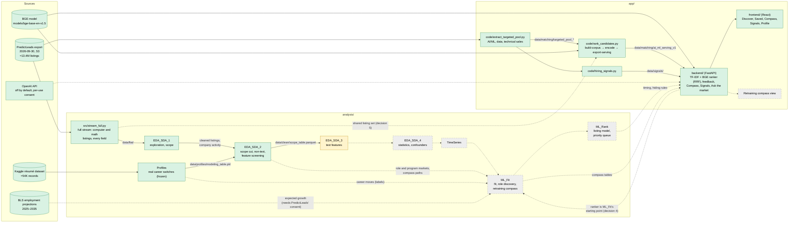

# How the pieces connect

One chart of the whole project: where the data comes from, what each notebook and script makes from it, and how it reaches the app. **Keep it current:** when a piece is built, a connection changes or a new piece appears, update the chart and the tables below in the same commit.

*Updated 2026-10-11. Decisions behind the planned connections: [`analysis/DECISION_LOG.md`](analysis/DECISION_LOG.md) (2026-10-11, the six merge decisions).*

## The chart

Solid boxes and arrows exist today; dashed ones are planned. Colors: green built, yellow in progress, grey planned.

## The pieces

| Piece | Where | Reads | Writes | Status |
|:--|:--|:--|:--|:--|
| Full stream | `analysis/src/stream_full.py` | PredictLeads export (S3) | `data/flat/`: every computer and mathematical listing with all fields, plus a slim table of every English US listing | Built; full run finished 2026-10-10 |
| EDA_SDA_1 | `analysis/notebooks/` | `data/flat/` | `data/clean/`: cleaned listings, company activity, occupation summary | Built, full scale |
| EDA_SDA_2 | `analysis/notebooks/` | EDA_SDA_1's tables, `data/profiles/modeling_table.pkl` | `data/clean/`: `scope_table.parquet` (the scope), role and program markets, compass paths, feature screening | Built, full scale |
| Profiles | `analysis/notebooks/Profiles.ipynb`, rules in `analysis/src/career_switch.py` | Kaggle résumé dataset (`data/external/`) | `data/profiles/`: `modeling_table.pkl`, `retrained_candidates.csv` | Built; frozen 2026-10-10 |
| EDA_SDA_3 | `analysis/notebooks/` | `scope_table.parquet` | Text features (cache: `data/clean/eda3_text.pkl`); the scope table with text features for EDA_SDA_4 and ML_Fit | In progress |
| EDA_SDA_4 | `analysis/notebooks/` | EDA_SDA_3's table | The modeling-ready table | Planned |
| TimeSeries | `analysis/notebooks/` | The scope's dates | Weekly series, lag features | Planned |
| ML_Fit | `analysis/notebooks/` | Scope with text features, Profiles, EDA_SDA_2's markets, BLS growth, the app's ranker | Fit scores, role suggestions, the retraining compass tables | Planned |
| ML_Rank | `analysis/notebooks/` | ML_Fit's scores, the modeling table | Listing model, priority queue, timing and hiding rules | Planned |
| Targeted pool | `app/code/extract_targeted_pool.py --scan` | PredictLeads export (S3) | `data/matching/targeted_pool_*` | Built; to be replaced by the shared listing set |
| Corpus and embeddings | `app/code/rank_candidates.py` | Targeted pool, BGE model | `data/matching/ai_ml_corpus_v1`, then `ai_ml_serving_v1` | Built |
| Hiring signals | `app/code/hiring_signals.py` | Targeted pool | `data/signals/hiring_signals_*` (company signals, weekly series, market table) | Built |
| Backend | `app/backend/` | Serving corpus, BGE model, signals; OpenAI when switched on | The API on port 8000 | Built |
| Frontend | `app/frontend/` | The API | The app on port 5173 | Built |
| Retraining compass view | `app/frontend/` | Compass tables, through the API | | Planned |

## Planned connections

| Connection | What changes | Source |
|:--|:--|:--|
| Shared listing set → app corpus | The app's corpus and embeddings are rebuilt from the analysis stream's listings (those with a usable description), replacing the targeted pool; embeddings recomputed for a set about three times larger | Decision 5 |
| App ranker → ML_Fit | TF-IDF + BGE with RRF is ML_Fit's baseline; ML_Fit adds what's missing and measures whether each addition beats it | Decision 4 |
| ML_Rank → backend | Timing (chance a listing is still open, apply-by date) and hiding rules reach the app | `analysis/PRIORITY_QUEUE.md` (combining the app with the analysis) |
| ML_Fit → backend → retraining compass view | The compass tables are served by the API and shown in a new view, next to the existing Compass tab (renamed "Saved-jobs insights") | Decision 6 |
| BLS → ML_Fit | Expected growth per role, after PredictLeads' written consent to combine data | `analysis/JOB_GROWTH.md` |
