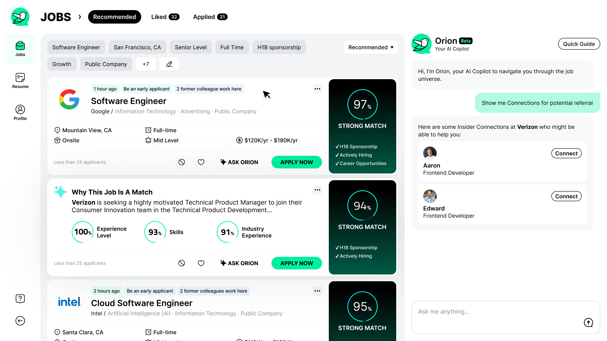
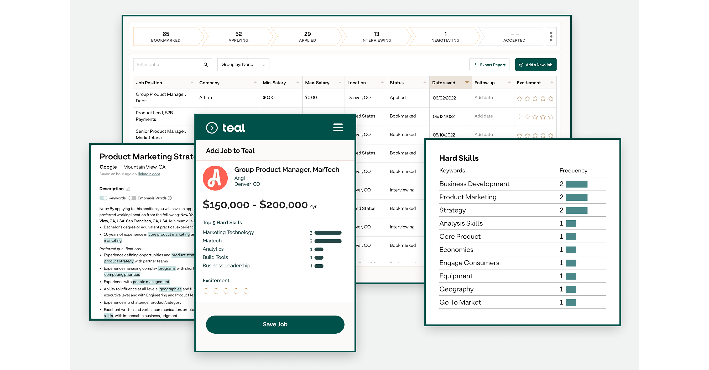
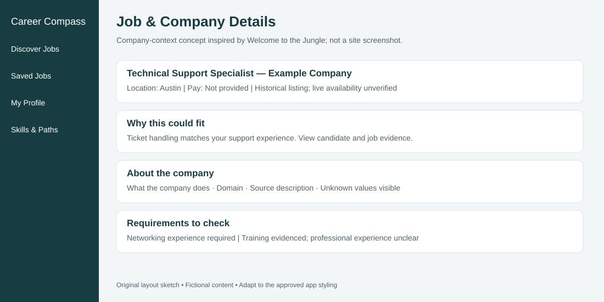
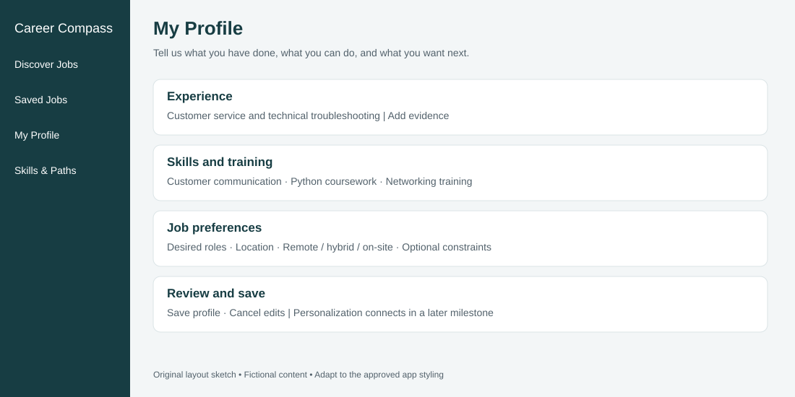
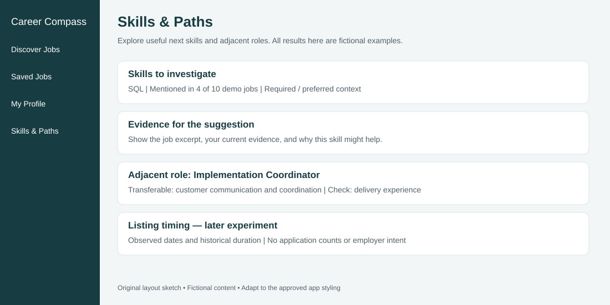

# UI Roadmap — Career Transition Job Platform

## Purpose and current starting point
Build a coherent mock application that helps candidates discover roles they may not know by title, understand the evidence behind a match, and organize opportunities. The existing Discover Jobs screen was reviewed and approved. Extend its components and styling; do not rebuild it from a different visual template.

This is the frontend roadmap. Matching, evaluation, and GenAI implementation remain separate workstreams. Functional mock pages come first; real recommendations and explanations connect later through typed interfaces.

## Visual references and what to borrow

Reference images are design-study material, not our product assets or a claim about the current appearance of these services. Do not ship their logos, screenshots, photos, or copied branding in the app. Use our approved colors and components across every screen.

| Reference | Borrow | Apply to | Do not borrow |
| --- | --- | --- | --- |
| Jobright | Scannable recommendation cards, compact filters, evidence near the opportunity | Discover Jobs and match detail | Unvalidated match percentages or applicant counts |
| Teal | Table of saved opportunities, stage filters, personal notes, skill context | Saved Jobs and skills detail | Browser extension, resume generation, outreach automation |
| Welcome to the Jungle | Company overview alongside opportunities; understandable employer context | Company section within job details | Culture claims, staff counts, photos, or benefits absent from our data |

### A. Discovery reference — Jobright

Source image: https://jobright.ai/blog/wp-content/uploads/2024/07/1.png

**What we like:** jobs remain the focal point; important information is grouped into cards and filters. Our approved implementation uses the right panel for details rather than a chat panel. Keep that decision. Fit explanations should show why a result was suggested, not just a score.

### B. Saved opportunities and skill evidence — Teal

Source image: https://mma.prnewswire.com/media/1833889/Teal_2.jpg?p=facebook
Product reference: https://www.tealhq.com/tools/job-tracker

**What we like:** the background table supports comparing opportunities; stages describe the candidate's progress. The skill panels demonstrate how evidence can sit beside a description. This is a promotional composite, not a screenshot of our app or proof of today's exact layout.

**Our adaptation:** a compact table on desktop, cards on mobile, user-selected stages and notes. Keep application stage separate from the source listing status. “Applied” means the user recorded an application; it does not mean the listing is open.

### C. Company context — Welcome to the Jungle

Reference page: https://www.welcometothejungle.com/en/companies

We borrow the idea of explaining what a company does before a candidate commits time. A verified interface screenshot was not captured for this reference. The following image is an original proposed layout, not a Welcome to the Jungle screenshot.

**Our adaptation:** company name, domain, source description, and explicit unknown values. Keep this inside job details for the MVP; a separate company directory is unnecessary. Full-company enrichment can connect after cross-file join coverage is validated.

## Shared experience and design rules

- Same sidebar, content width, typography, spacing, colors, buttons, cards, badges, and focus states everywhere. Inspect the existing frontend and reuse its tokens.
- Proposed navigation: Discover Jobs, Saved Jobs, My Profile. Add Skills & Paths only when that page works; no dead navigation.
- Desktop: preserve discovery's three-column workspace. Other pages reuse the sidebar and content shell; they do not need three columns.
- Mobile: compact navigation, stacked content, full-width details with a Back control, no clipped tables or horizontal page overflow.
- Missing values are visible. Do not fabricate pay, location, skills, current availability, or company information.
- Every mock insight is marked as fictional/demo. User-entered values persist locally. The browser is not an account or a secure resume store.
- No resume upload or real PII in the mock milestone. No external calls. Preserve the existing fictional candidate and jobs as fixtures.

## Build order and acceptance criteria

### 1. Preserve Discover Jobs and establish shared navigation

**Status:** first screen implemented and visually approved.

Keep search, location/work arrangement/description filters, selected-job details, save controls, empty states, historical markers, and source links. Add routes and browser back/forward behavior. Retain search/filter state on navigation where practical. Do not change its visual design without review.

**Done when:** direct page navigation works, selection and filters still work, desktop/mobile previews remain consistent, and no unimplemented item appears clickable.

### 2. My Profile — structured candidate input

**Layout:** grouped form sections for experience, skills/training, and preferences; preview of the saved profile; Save and Cancel actions.

**Fields:** experience entries or summary; evidenced skills with optional evidence text; desired roles; location; work arrangement preferences. Years, education, and credentials may be optional explicit fields when present in the backend contract. Do not infer them.

**Behavior:** start with the fictional candidate. Edit a draft, validate sensible input, save with confirmation, cancel back to saved values, persist across refresh. Handle malformed stored data and offer reset-to-demo. Explain that mock match labels remain fixtures until personalized ranking is connected.

**Done when:** save/cancel/reload work, labels and keyboard focus are accessible, and editing a profile does not silently present unchanged demo explanations as newly personalized results.

### 3. Saved Jobs — Teal-inspired opportunity tracker

**Layout:** stage filters above a table: Job, Company, Location, Pay, My stage, Date saved. Selecting a row opens the existing job detail component. Use cards on narrow screens.

**Stages:** Saved, Considering, Applied, Interviewing, Archived. These are user-entered workflow states, not PredictLeads job statuses. No need for a drag-and-drop board initially.

**Behavior:** save/unsave from discovery or details; update stage; add a short private local note; search and filter saved opportunities; persist by stable job ID. Show an empty state that links to Discover Jobs. Provide remove with undo or confirmation.

**Done when:** state stays synchronized across pages and refreshes; stages/notes persist; missing pay/location do not become misleading defaults; no duplicate saves appear.

### 4. Job and company detail — evidence before persuasion

Use the existing panel, not a separate visual system. Add sections or tabs only if they improve readability: Overview, Match Evidence, Company.

**Contents:** source description; relevant candidate/job evidence; requirements to check; available company context; observation dates and historical status; source link. Mock links remain clearly identified placeholders.

**Done when:** match rationale is distinguishable from source text; requirements not evidenced are described as unknown; missing descriptions have a useful fallback state; company context does not invent information. Source links use safe external-link handling.

### 5. Skills & Paths — our career-transition differentiator

Build this as a secondary mock milestone after pages 1–4 work. One page with two tabs is sufficient.

**Skills tab:** compare profile evidence with requirements in selected/saved jobs. Show a short list of skills to investigate, the source excerpt, required/preferred/unclear context, and an explanation. A demo opportunity count must identify its denominator; avoid fake market-wide numbers.

**Paths tab:** show 3–5 fictional adjacent role families, transferable evidence, requirements to check, and a button that applies a discovery filter. Do not claim the candidate is qualified or will be hired.

**Done when:** every suggestion has visible evidence and demo labeling; selecting an adjacent path leads somewhere useful; counts reflect fixtures or are clearly fictional. If a feature is unimplemented, omit it rather than show a fake working control.

### 6. Historical timing — conditional stretch component

Prototype within job details only after a validated timing model and display contract exist. Potential display: first observed, last observed, and historical listing-duration context. “Apply priority” can later combine fit and an explicitly defined timing signal.

Do not mock competition, application volume, employer intent, or current-open probability as established facts. Do not give urgency badges a production appearance before validation. Market momentum, if added, needs a defined occupation/geography/time window and historical coverage caveats.

### 7. Connect the prepared data and ML/GenAI outputs

Only after the mock experience is reviewed:
1. Agree typed request/response schemas with backend development.
2. Replace fixtures through a data adapter; preserve approved components.
3. Connect profile input, filters, ranked results, evidence, and company fields.
4. Connect grounded GenAI explanation and skills-gap outputs.
5. Add loading, timeout, unavailable-insight, and request-error states.
6. Verify an end-to-end candidate journey and document measured limits.

User-entered tracker state stays separate from model results and source listing status. Backend connection does not authorize a visual redesign.

## Implementation boundaries and validation

All mock-page changes stay in frontend/. No Python, data, root docs, branch switching, commits, pushes, AWS, backend, or external AI calls during this UI milestone. Do not add dependencies unless they serve a concrete requirement.

After each meaningful milestone: run production build and relevant interaction checks; inspect rendered desktop and narrow layouts when browser tools are available. Check navigation, persistence, empty states, selected details, wrapping, keyboard access, and console errors. Do not claim a visual check from compilation alone.

Keep localStorage schema versioned and validate stored values. Changing a profile must mark derived insights as stale when backend integration is added. Real resumes later require consent and PII handling before external processing.

## Recommended next assignment

Complete milestones 1–4 with the approved design and mock data. Stop after a concise browser review report before building Skills & Paths. This provides a coherent MVP shell without delaying the matching experiment. Then implement milestone 5 as a separately reviewed mock page; keep milestone 6 conditional.

Record completed milestones and remaining limitations in frontend/README.md. Keep individual names and coding-assistant references out of product documentation.

## Reference inventory

- references/jobright.png — retrieved product reference image; external design-study material.
- references/teal.jpg — retrieved promotional composite; external design-study material.
- references/profile.svg — original proposed layout, not a product screenshot.
- references/company.svg — original proposed layout, not a product screenshot.
- references/skills.svg — original proposed layout, not a product screenshot.

Images are guidance; the approved Discover Jobs implementation remains the visual baseline. Inspect both the reference images and the actual current screen before extending components.
