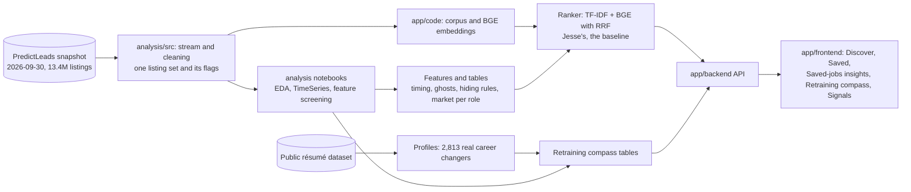

# Merge plan: `project_leads` (Jacob) + `predictleads-hackathon` (Jesse)

**A proposal for Jesse and Jacob to confirm.** Updated 2026-10-10. Nothing is merged until we both agree on the six decisions in section 3.

## 1. The short version

- **One repository,** with both commit histories kept: the app in `app/`, the analysis in `analysis/`, one set of docs, one data layout.
- **When:** as soon as the four readiness gates in section 5 are met, not on a fixed date. The pace-setter is agreeing on the six decisions; the rest takes a day or less. The project's target date is about 2026-10-23.
- **Why now:** the two projects have converged on the same product (career changers, the 2026-09-30 snapshot, a ranked list, a "Compass"), and each has what the other lacks. Merging early stops us building the same thing twice.

## 2. The two repositories, and the merged one

### Today, side by side

```
project_leads/  (Jacob: analysis)            predictleads-hackathon/  (Jesse: app)
├── notebooks/                               ├── backend/        FastAPI: api, rrf_ranker, feedback_ranking,
│   ├── EDA_SDA_1–4, TimeSeries              │                   compass, signals (+ tests)
│   ├── Profiles  (real career switches)     ├── frontend/       React + Vite: Discover, Saved, Compass,
│   └── ML_Fit, ML_Rank  (planned)           │                   Signals, Profile
├── src/                                     ├── code/           data scan, corpus, BGE text, ranking,
│   ├── stream_full.py  (full-file stream)   │                   role classifier, résumé fill, signals
│   ├── listing_rows.py (cleaning rules)     ├── tests/
│   ├── career_switch.py (role buckets)      ├── notebooks/      data_discovery
│   ├── eda_helpers.py, pl_data.py           ├── docs/           API, data prep, matching engine, signals
│   └── export_markdown.py                   ├── archive/        earlier experiments
├── docs/        decisions, data, plans      ├── README.md, STATUS.md, roadmap.md
├── PROJECT_OUTLINE, STANDARDS, COMPASS,     ├── requirements.txt (19 packages)
│   APPLICATION, DIFFERENTIATORS,            ├── run_demo_backend / run_tests (.ps1, .sh)
│   PRIORITY_QUEUE, CLAUDE.md                ├── .env.example (OPENAI_API_KEY)
├── requirements.txt (187 packages)          ├── data/    (git-ignored)
├── .env.example                             └── models/  (git-ignored: local BGE model)
└── data/        (git-ignored)
```

### After the merge

```
predictleads-hackathon/              (name agreed 2026-10-10; in a shared GitHub organization)
├── app/
│   ├── backend/        Jesse's API, plus timing, hiding rules and the retraining compass
│   ├── frontend/       Jesse's React app, plus the retraining compass view
│   ├── code/           Jesse's corpus, BGE and ranking code, built on the shared listing set
│   └── tests/
├── analysis/
│   ├── notebooks/      EDA_SDA_1–4, TimeSeries, Profiles, ML_Fit, ML_Rank
│   └── src/            stream, cleaning rules, role buckets, helpers
├── docs/
│   ├── project/        Jacob's docs, unchanged: PROJECT_OUTLINE, STANDARDS, COMPASS,
│   │                   APPLICATION, DIFFERENTIATORS
│   ├── analysis/       decisions, data, job growth, fit analysis, merge plan, notebook exports
│   └── app/            Jesse's docs: API, data prep, matching engine, signals, roadmap
├── README.md           one map of the repository, for both sides
├── PRIORITY_QUEUE.md   the one task list, kept intact (Jesse's remaining work added as items)
├── STATUS.md           Jesse's: how to run the app and where it stands
├── CLAUDE.md           stays at the top (Claude Code reads it there)
├── requirements.txt    one pinned list for both
├── .env.example        S3 settings and OPENAI_API_KEY as placeholders
├── data/               git-ignored: one layout, rebuilt from the same snapshot
└── models/             git-ignored
```

### How the pieces connect after the merge



## 3. Six decisions to confirm first

### Decision 1: which jobs are in the project, and how they're labelled

- **Jacob has:** every listing whose O*NET occupation is in the **Computer and Mathematical** group (codes starting 15-), minus credentialed math (actuaries, mathematicians), sorted into **8 role buckets**: IT support, networks and systems, security, database, software development, quality assurance, data science, IT project management. The same buckets label the career changers in Profiles, which is how the retraining compass joins "where people moved" to "today's openings". About 1.0 million listings in the full file.
- **Jesse has:** listings chosen by job title and occupation for **three target areas: AI/ML, data, and technical sales / solutions engineering** (about 320,000; the app serves about 81,000). A 17-class role classifier exists but isn't used by the app.
- **Where they differ:** AI/ML and data roles are inside Jacob's scope (mostly "data science" and "software development"). **Technical sales is not:** sales engineers are in O*NET's *Sales* group. Jacob's IT support, networks, security, QA, database and IT project management roles aren't in Jesse's.
- **Proposed:** one combined set: Jacob's computer and mathematical scope **plus technical sales as a ninth bucket**. Jesse's three areas become app filters that map onto the buckets. Technical sales gets listings but no retraining-compass paths (Profiles has no technical-sales career changers).

### Decision 2: which listings count as "still open"

- **Jacob has:** a listing is open if it was **last seen within 2 days** of the 2026-09-30 snapshot. The `status` field is only ever "closed" or empty, never "open", so it isn't used. (Checked: the crawler isn't weekly, so the 2-day rule doesn't drop open listings.)
- **Jesse has:** the app drops `status = closed` and **shows every listing with an empty status**, labelled "unknown, not verified as open". That includes listings last seen weeks or months before the snapshot, which have most likely disappeared.
- **Proposed:** the app uses the last-seen rule, so users don't see listings that are already gone, and keeps Jesse's honest "historical listing" wording. With the planned date picker, "open" means live on the chosen date.

### Decision 3: sending text to outside AI (OpenAI)

- **Jacob has:** the project advisors' rule: **no PredictLeads data or listing text goes to outside AI tools.** In the app design, anything that reads listing text runs locally. Whether an outside model may ever see listing text is an open question to the advisors.
- **Jesse has:** two features that call OpenAI (`gpt-4.1-mini`), both off by default:
  - **Magic fill:** sends a résumé's text (contact details removed) to fill in the profile; the user ticks a consent box each time.
  - **Grounded explanations:** in OpenAI mode, **the listing's description and the candidate's evidence are sent to the provider** (his `docs/grounded-match-explanations.md`).
- **Proposed:** both stay **off by default**. **Grounded explanations in OpenAI mode are not used** until the advisors allow listing text to go to an outside model (the local mock stays for development). Magic fill only with the person's consent, as now, and pending the advisors' answer on résumés.

### Decision 4: who ranks the jobs

- **Jacob has:** a *plan*, not built yet. `ML_Fit` suggests roles from a person's background using the same steps Jesse built (keywords, TF-IDF, BGE embeddings, combined with RRF), then a model trained on the 2,813 real career moves. `ML_Rank` adds a timing model (chance a listing is still open, an apply-by date) and combines fit, accessibility and pay into one priority score.
- **Jesse has:** a **working ranker**: a profile goes in, listings are scored with TF-IDF and BGE, combined with RRF, and updated as the user rates jobs (👍/👎). Its quality hasn't been tested (the planned human review was dropped for time).
- **Proposed:** don't rebuild it. **Jesse's ranker is the starting point** of `ML_Fit`. Jacob adds what's missing (role suggestions learned from real career moves, the timing model, the hiding rules) and measures whether each addition beats Jesse's ranker.

### Decision 5: how the data is prepared

- **Jacob has:** `src/stream_full.py` keeps **all computer and mathematical listings with every field**, plus a slim table of every English US listing (for company hiring volume). Cleaning rules in `src/listing_rows.py` (hourly pay, reposts, text flags); EDA_SDA_2's flags (ghost listings, staffing agencies, accessibility). Listings without a description are kept and flagged.
- **Jesse has:** his own scan of the same file (`code/extract_targeted_pool.py`) keeps his ~320,000 target-area listings; his corpus keeps those **with a usable description** (~245,000) and collapses exact duplicates; BGE embeddings computed on his GPU.
- **Why it matters:** two pipelines give two listing counts, two duplicate rules and two ideas of what's included, so the app and the analysis would disagree.
- **Proposed:** Jacob's stream and cleaning define the listings and their flags; Jesse's corpus and embedding steps run on that set (listings with a usable description). **Cost:** his embeddings are recomputed for the larger set (roughly three times today's, a few hours on his GPU).

### Decision 6: what "Compass" means

- **Jacob has:** the **retraining compass**, the project's foundation from the team meeting: prior career → training people took → first tech job → that role's 2026 openings, pay and closing speed (Profiles and EDA_SDA_2).
- **Jesse has:** a **Compass tab**: pick 3–20 saved jobs and see their common themes, fit tiers, how the profile lines up with each requirement (with evidence lines), next steps and "hidden fit" suggestions. Runs locally.
- **Proposed:** keep both (they answer different questions) under different names, for example **"Saved-jobs insights"** for Jesse's tab and **"Retraining compass"** for Jacob's paths. Which one keeps the word "Compass" is our call.

## 4. Smaller conflicts (mechanical)

| Conflict | Resolution |
|:--|:--|
| `README.md`, `requirements.txt`, `.gitignore`, `.env.example`, `notebooks/`, `docs/` exist in both | Merge each into one |
| **`sentence-transformers` 5.1 (Jesse) vs. 6.1 (Jacob)**, a major version; 9 other pins differ; FastAPI and uvicorn only on Jesse's side | One pinned `requirements.txt`. Check Jesse's ranker and embeddings on 6.1, or pin one version for both |
| Docs on both sides; some overlap | **Nothing is deleted.** Top level keeps four files: `README.md` (one map), `PRIORITY_QUEUE.md` (**intact, the one task list**), `STATUS.md` (Jesse's run-and-status page) and `CLAUDE.md`. Jacob's other docs move unchanged to `docs/project/`; analysis docs to `docs/analysis/`; Jesse's to `docs/app/`. Only true overlap is removed: `roadmap.md`'s goal and user journey fold into `PROJECT_OUTLINE.md`, its remaining work into `PRIORITY_QUEUE.md`; the rest stays as `docs/app/roadmap.md`. Every link between docs (and the paths in `CLAUDE.md`) is updated in the same commit |
| The S3 location is written in Jesse's committed docs; Jacob's rule keeps it only in `.env` | Move it to `.env.example` as a placeholder |
| Windows scripts (`.ps1`) and Mac scripts (`.sh`); `.venv` vs. `PL` | Keep both script sets; one venv name in the README |
| Notebook outputs | `nbstripout` for the whole repo |
| Data rules and assistant instructions (`CLAUDE.md`) | Apply repo-wide |
| `code/` and `src/` | Keep both; consolidate after the deadline |
| Signals (Jesse) vs. planned company-history features and watch list (Jacob) | Signals stays; combine later |

## 5. Readiness gates

**Before the merge (all four):**

| Gate | Ready when | Who |
|:--|:--|:--|
| 1. Decisions agreed | Both confirm (or change) decisions 1–6 and log them | Jesse and Jacob |
| 2. Streams finished | Jacob's full stream and its second pass (`--rows`) have completed | Jacob |
| 3. Nothing in flight | Both repos committed and pushed; `feature/mac-support` merged into `main`; no run in progress | Jesse and Jacob |
| 4. Paths ready | Each side finds the project root and `data/` through a setting, not "the folder with `requirements.txt`"; tested before merging | Jacob's side (Claude); Jesse's side |

**After the merge:** the full-file rerun of the analysis notebooks; rebuilding the app's corpus and embeddings from the shared listing set; wiring timing, hiding rules and the retraining compass into the backend; consolidating code.

## 6. Steps

- [ ] Gates 1–4 met
- [ ] Create a shared GitHub organization; move both repos into it (each owner moves their own)
- [ ] On a merge branch: each repo's files moved into `app/` or `analysis/` (`git mv`), docs into `docs/project/`, `docs/analysis/` and `docs/app/`, histories joined (`git merge --allow-unrelated-histories`), shared files merged, links between docs updated
- [ ] App tests pass; notebooks run on the new layout
- [ ] One pull request, reviewed by both, merged to `main`
- [ ] Then: shared listing set → corpus and embeddings → backend features
